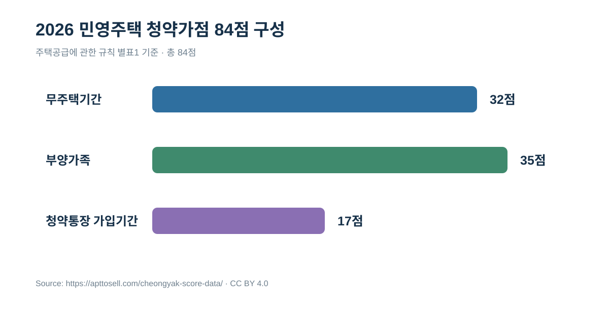

# Embed & reuse

AptToSell의 청약가점 차트와 CSV를 기사·블로그·가이드에 사용할 수 있습니다. 원문 URL과 자료 기준일의 출처 표기를 권장합니다. 검색 순위용 링크 삽입은 의무가 아니며 링크 속성은 게시자가 선택합니다.

## Chart embed

### Markdown

```markdown
[](https://apttosell.com/cheongyak-score-data/)
```

### HTML

```html
<a href="https://apttosell.com/cheongyak-score-data/" target="_blank" rel="noopener">
  
</a>
<p>자료: <a href="https://apttosell.com/cheongyak-score-data/">AptToSell 2026 청약가점 84점 데이터표</a></p>
```

## One-line source link

### HTML

```html
<p>출처: <a href="https://apttosell.com/housing-subscription-data/" target="_blank" rel="noopener">AptToSell 청약·분양 데이터센터</a></p>
```

### Markdown

```markdown
출처: [AptToSell 청약·분양 데이터센터](https://apttosell.com/housing-subscription-data/)
```

## Suggested reuse blocks

### 청약가점 계산기 링크

```html
<a href="https://apttosell.com/cheongyak-score-calculator/" target="_blank" rel="noopener">2026 청약가점 계산기</a>
```

### 청약가점 데이터 링크

```html
<a href="https://apttosell.com/cheongyak-score-data/" target="_blank" rel="noopener">2026 청약가점 84점 데이터</a>
```

## CSV

https://raw.githubusercontent.com/cheer710815-hub/apttosell-subscription-data/main/housing_subscription_score_2026.csv

## License

기존 CSV/차트 중 CC BY 4.0 적용 대상에는 해당 라이선스의 출처표시 조건이 적용됩니다. 원문 링크는 권장하지만 특정 검색용 백링크를 필수로 요구하지 않습니다. 제3자 자료는 별도 조건을 확인하세요.


## Interactive widget

청약가점 계산기를 외부 블로그·교육자료·가이드에 삽입할 수 있습니다. 기본 설정은 출처 링크를 자동 삽입하지 않습니다. 출처 링크를 표시하려면 컨테이너에 `data-show-source="true"`를 추가하세요. 링크 의무나 강제 속성은 없으며, 텍스트 출처 표기도 가능합니다. 2026-11-20 교육용 v0.2는 배우자 인정점수 입력·17점 상한·여러 위젯 배치를 지원합니다.

### HTML embed

```html
<div data-apttosell-score-widget></div>
<script src="https://cdn.jsdelivr.net/gh/cheer710815-hub/apttosell-subscription-data@6330f9ef5acf85ef6510def8758ead38cdfcea65/widgets/apttosell-score-widget.js"></script>
```

### Widget source

- https://github.com/cheer710815-hub/apttosell-subscription-data/blob/main/widgets/apttosell-score-widget.js

### Canonical source

- https://apttosell.com/cheongyak-score-calculator/
